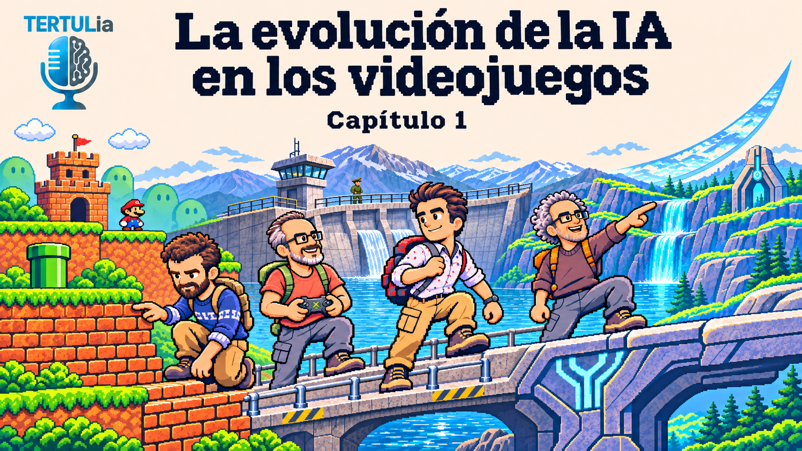

# La evolución de la IA en los videojuegos

- [ Spotify](https://open.spotify.com/episode/62OUPEW0AKocjbeh2NcZ7O?si=vsNXj2zfQYaIkOr2j55_6Q)
- [ Youtube](https://youtu.be/YH-vRC7qpKg)
- [ Ivoox](https://go.ivoox.com/rf/183413245)
- [ Apple Podcasts](https://podcasts.apple.com/us/podcast/la-evoluci%C3%B3n-de-la-ia-en-los-videojuegos/id1669083682?i=1000800250158)

Recorremos la historia de la inteligencia artificial en los videojuegos, desde las primeras recreativas hasta GoldenEye, Halo y Halo 2, explorando cómo evolucionaron la percepción, la memoria y la toma de decisiones de los personajes.
Descubrimos cómo las limitaciones del hardware, la IA simbólica y los ingeniosos trucos de los desarrolladores dieron vida a enemigos cada vez más inteligentes, pero diseñados para dejarse ganar.

Participan en la tertulia: Paco Zamora, Iñigo Olcoz, Josu Gorostegui y Guillermo Barbadillo.

Recuerda que puedes enviarnos dudas, comentarios y sugerencias en: <https://twitter.com/TERTUL_ia>